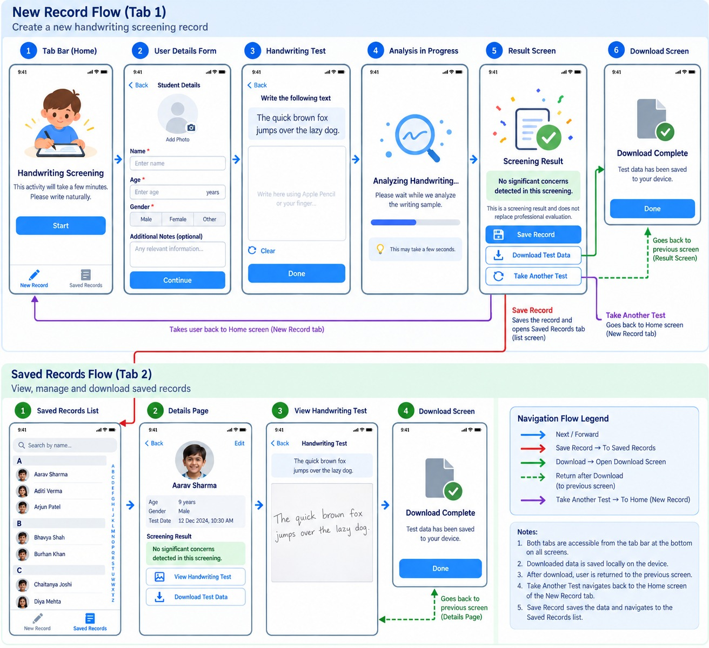

# Dysgraphia Screening App - Requirements (Phase 1)

## What is this app?

An iPad app that helps spot early signs of dysgraphia (a writing difficulty) in children. A child writes a short sentence on the iPad, the app looks at the handwriting, and shows a simple screening result.

The result is only a first check - it does **not** replace a proper assessment by a professional.

## Wireframes



## Who will use it?

- Teachers, parents or specialists running the screening
- The child, who does the writing part

## How the app is organised

The app has two tabs at the bottom, visible on every main screen:

1. **New Record** - start a new handwriting screening
2. **Saved Records** - see and manage past screenings

---

## Tab 1 - New Record

### Screen 1: Home

- A friendly picture of a child writing on a tablet
- Title: "Handwriting Screening"
- Short message: "This activity will take a few minutes. Please write naturally."
- **Start** button - goes to Student Details

### Screen 2: Student Details

- **Back** button
- **Add Photo** - optional photo of the student
- **Name** - required
- **Age** (in years) - required
- **Gender** - required, choose one: Male / Female / Other
- **Additional Notes** - optional, for anything useful to know
- **Continue** button - goes to the Handwriting Test
- The user cannot continue until all required fields are filled in

### Screen 3: Handwriting Test

- **Back** button
- Instruction: "Write the following text"
- The sentence to copy: *"The quick brown fox jumps over the lazy dog."*
- A large blank writing area - the child writes using Apple Pencil or a finger
- **Clear** button - wipes the writing area to start again
- **Done** button - sends the writing for checking

### Screen 4: Analysing Handwriting

- A simple animation showing the app is working
- Message: "Analysing handwriting... Please wait while we analyse the writing sample."
- A progress bar
- Tip: "This may take a few seconds."
- Moves to the Result screen automatically when finished

### Screen 5: Screening Result

- Title: "Screening Result"
- The result in a clear, highlighted box (for example: "No significant concerns detected in this screening.")
- Note: "This is a screening result and does not replace professional evaluation."
- Three buttons:
  - **Save Record** - saves the screening and takes the user to the Saved Records list
  - **Download Test Data** - saves the test data to the iPad and opens the Download screen
  - **Take Another Test** - goes back to the Home screen to start again

### Screen 6: Download Complete

- Confirmation: "Download Complete - Test data has been saved to your device."
- **Done** button - goes back to the Screening Result screen

---

## Tab 2 - Saved Records

### Screen 1: Saved Records List

- **Search bar** - search students by name
- List of saved students, sorted A to Z and grouped by first letter
- Each row shows the student's photo and name
- A letter index (A-Z) down the side to jump quickly through the list
- Tapping a student opens their Details page

### Screen 2: Student Details Page

- **Back** button and **Edit** button (to update student details)
- Student photo and name
- Age, Gender and Test Date (with time)
- Screening Result box
- **View Handwriting Test** button - shows what the child wrote
- **Download Test Data** button - saves the data to the iPad and opens the Download screen

### Screen 3: View Handwriting Test

- **Back** button
- The sentence the child was asked to write
- The child's actual handwriting, shown exactly as written

### Screen 4: Download Complete

- Same as in Tab 1: "Download Complete - Test data has been saved to your device."
- **Done** button - goes back to the Student Details page

---

## Navigation Flow

### New Record flow

```
Home -> Student Details -> Handwriting Test -> Analysing -> Screening Result
```

From the Screening Result screen:

| Button             | Where it goes                                  |
|--------------------|------------------------------------------------|
| Save Record        | Saves, then opens the Saved Records list (Tab 2) |
| Download Test Data | Download Complete -> Done -> back to Result    |
| Take Another Test  | Home screen (Tab 1)                            |

### Saved Records flow

```
Saved Records List -> Student Details Page -> View Handwriting Test
```

From the Student Details Page:

| Button                | Where it goes                                   |
|-----------------------|-------------------------------------------------|
| View Handwriting Test | Shows the child's writing                       |
| Download Test Data    | Download Complete -> Done -> back to Details    |
| Edit                  | Lets the user update the student's details      |

---

## General Rules

- Both tabs can be reached from the tab bar at any time
- All records and downloads are kept on the iPad itself (no online account needed)
- After a download, the user always returns to the screen they came from
- **Save Record** saves the data and takes the user to the Saved Records list
- **Take Another Test** always goes back to the Home screen of the New Record tab
- The result must always show the reminder that this is a screening, not a diagnosis

## Not in this phase

- User login or accounts
- Syncing records between devices
- Sharing results by email or other apps
- Multiple test sentences or different test types
- Detailed reports or scores
